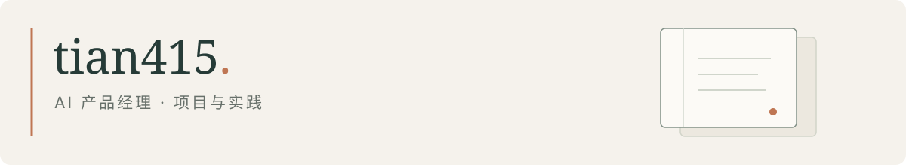

做一些自己用的工具，也在这里记录学习和实践。

### 项目

| 项目 | 在做什么 | 当前进展 |
| :--- | :--- | :--- |
| [**Knowledge Agent**](https://github.com/tian415/knowledge-agent) 笔记整理 | 把 AI 对话整理成 Markdown 笔记，保存前查看来源和改动。 | 有本地演示，无需 API Key |
| [**EchoVault**](https://github.com/tian415/echovault) 辅助写作 | 用自己过去的文字作为参考，尝试辅助起草新内容。 | 本地工具原型 |

### 关于这些项目

开发过程中会用 AI 帮忙。项目以个人使用和实验为主，还在修改；具体实现、运行方法和限制放在各自的 README 里。

想试一试的话，可以从 [Knowledge Agent 的本地演示](https://github.com/tian415/knowledge-agent#三步体验)开始。
